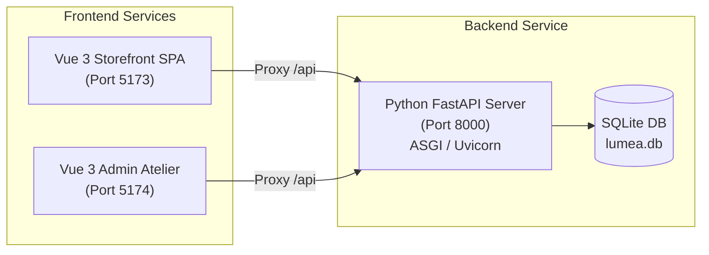

# LUMÉA — Atelier E-Commerce System Context & Memory
> **Purpose**: This file is the primary context and memory document for Antigravity and any AI assistant working on the Luméa codebase (both locally and remotely). Read this file first to understand the architecture, completed milestones, database state, and active priorities.

---

## 🌟 1. Project Overview & Mission
- **Project Name**: Luméa — Contemporary Skincare & Beauty Atelier
- **Target**: University Final Project (Undergraduate/Graduate Computer Science degree evaluation)
- **Design Inspiration**: Minimalist luxury Asian skincare, warm bisque aesthetics (`#F5EFEB`, `#7A2E22`), typography (Playfair / Inter / Serif accents), authentic dermatological curation.
- **Visual Design Reference Mockups**: High-resolution PNG format specifications located in [`format/`](file:///d:/lumea/format).

---

## 🏗️ 2. System Architecture & Port Mapping

The project consists of three decoupled components communicating via RESTful APIs:



| Service | Technology | Path | Dev URL | Notes |
| :--- | :--- | :--- | :--- | :--- |
| **Storefront** | Vue 3, Pinia, Vue Router, Vite | [`d:/lumea/frontend/`](file:///d:/lumea/frontend) | `http://localhost:5173` | Proxies `/api` -> `http://127.0.0.1:8000` |
| **Admin Console** | Vue 3, Pinia, Chart.js, Vite | [`d:/lumea/admin/`](file:///d:/lumea/admin) | `http://localhost:5174` | Atelier management dashboard |
| **Backend API** | Python 3.12, FastAPI, SQLAlchemy 2.0 | [`d:/lumea/python-backend/`](file:///d:/lumea/python-backend) | `http://127.0.0.1:8000` | Swagger docs at `http://127.0.0.1:8000/docs` |
| **Database** | SQLite 3 | [`d:/lumea/python-backend/lumea.db`](file:///d:/lumea/python-backend/lumea.db) | File-based | Zero-config, portable for grading |

---

## 🐍 3. Python FastAPI Backend Details

The backend was built in [`python-backend/`](file:///d:/lumea/python-backend) to replace legacy PHP/Laravel code for the user's final project.

### Architecture Pattern:
- **Clean Layered Architecture**:
  - `app/core/`: Configuration (`config.py`), Database session (`database.py`), Security & JWT (`security.py`).
  - `app/models/`: SQLAlchemy ORM models (`user.py`, `category.py`, `product.py`, `order.py`, `banner.py`).
  - `app/schemas/`: Pydantic v2 DTOs with validation (`user.py`, `category.py`, `product.py`, `order.py`, `banner.py`).
  - `app/api/`: REST Controllers (`system.py`, `auth.py`, `categories.py`, `products.py`, `orders.py`, `banners.py`).
  - `app/seed/`: Fixture loading and automatic database seeding (`seed_data.json`, `seed_data.py`).

### Key Endpoints:
- `GET /api/health` — Service health check
- `GET /api/categories` — 8 skincare categories with dynamic product counts
- `GET /api/products` — Filterable catalog (search, category, brand, price, skin type, skin concern, sort)
- `GET /api/products/{slug}` — Single product details with related items
- `GET /api/products/featured` — Featured showcase items
- `POST /api/auth/register` & `POST /api/auth/login` — Bcrypt hashed auth with JWT tokens
- `GET /api/auth/me` — Protected user profile (`Authorization: Bearer <token>`)
- `POST /api/orders` — Checkout submission with automated tax, discount code, and `LUM-XXXXXX` order generator
- `GET /api/orders/{orderNumber}` — Order tracking details
- `GET /api/banners` & `GET /api/banners/{page}` — Dynamic page banner CMS (Home, Shop, Deals, etc.)

### Demo User for Grading & Testing:
- **Email**: `sreynich.chan@example.com`
- **Password**: `password123`
- **Role**: `customer` | **Tier**: `Luméa Radiant Gold` (320 pts)

---

## 🎨 4. Storefront UI Inventory & Roadmap

A comprehensive audit of [`format/`](file:///d:/lumea/format) mockups against [`frontend/src/views/`](file:///d:/lumea/frontend/src/views) revealed:

### ✅ Completed Storefront Views (37 Pages + Modals):
1. `HomeView.vue` (`/`) — Hero, Bestsellers, Skin Quiz CTA, Philosophy, Atelier Features
2. `ShopView.vue` (`/shop`) — Full catalog with sidebar filters & sorting
3. `CategoryView.vue` (`/category/:slug`) — Category-filtered catalog with custom banner
4. `BrandListingView.vue` (`/brands`) — A-Z Brand directory with logos and counts
5. `BrandStoreView.vue` (`/brand/:slug`) — Official brand flagship store
6. `ProductDetailView.vue` (`/product/:slug`) — Gallery, accordions, ingredients, reviews
7. `SearchView.vue` (`/search`) — Search query results with multi-attribute filtering
8. `BestSellersView.vue` (`/best-sellers`) — Top rated products
9. `NewArrivalsView.vue` (`/new-arrivals`) — Freshly added formulations
10. `DealsView.vue` (`/deals`) & `AllDealsView.vue` (`/deals/all`) — Promotional sales
11. `ConcernsView.vue` (`/concerns`) — Skin concerns & skin types filter matrix
12. `WishlistView.vue` (`/wishlist`) — Saved items with move-to-bag actions
13. `CartView.vue` (`/cart`) & `CartDrawer.vue` — Shopping bag and slide-out cart
14. `CheckoutView.vue` (`/checkout`) — Order checkout form
15. `OrderSuccessView.vue` (`/order-success/:orderNumber`) — Confirmation page
16. `SkinQuizIntroView.vue` (`/quiz`) — Interactive diagnostic entrance
17. `SkinQuizQuestionsView.vue` (`/quiz/questions`) — 5-step diagnostic quiz
18. `QuizResultsView.vue` (`/quiz/results`) — Skin profile analysis
19. `RecommendedRoutineView.vue` (`/routine`) — Morning & Evening personalized regimen
20. `LoginRegisterView.vue` (`/login`, `/register`) — Tabbed auth with validation
21. `MyAccountView.vue` (`/account`) — Customer dashboard overview
22. `MyOrdersView.vue` (`/account/orders`) — Order history list with tracking links
23. `OrderDetailsView.vue` (`/account/orders/:orderNumber`) — Itemized invoice & timeline
24. `SkinProfileView.vue` (`/account/profile`) — Customer skin metrics & concerns
25. `SkincareJournalView.vue` (`/account/journal`) — Personal daily skincare diary & photo logs
26. `AboutView.vue` (`/about`) — Atelier story, founders, and craftsmanship
27. `AuthenticityView.vue` (`/authenticity`) — 100% genuine promise & laboratory sourcing
28. `ContactView.vue` (`/contact`) — Concierge inquiry form & office details
29. `FaqView.vue` (`/faq`) — Searchable accordion help center
30. `ShippingView.vue` (`/shipping`) — Delivery methods & international transit times
31. `ReturnsView.vue` (`/returns`) — 30-day return policy overview
32. `NotFoundView.vue` (`/:pathMatch(.*)*`) — Editorial 404 Error page (*Luméa 404_ error-not-found.png*)
33. `PrivacyPolicyView.vue` (`/privacy-policy`) — 13-point editorial privacy policy (*Luméa Privacy Policy Editorial Page.png*)
34. `TermsOfServiceView.vue` (`/terms-of-service`) — 15-point editorial terms of service (*Luméa Terms of Service Editorial Webpage.png*)
35. `ArticlesView.vue` (`/articles`) — Skincare Journal 8-category directory (*Luméa Skincare Journal Website.png*)
36. `ArticleDetailView.vue` (`/articles/:slug`) — Dermatological reader view with TOC & related articles (*Article Details.png*)
37. `SustainabilityView.vue` (`/sustainability`) — Sustainability & botanical promise (*Luméa Sustainability.png*)
38. `ReturnRequestView.vue` (`/returns/request`) — 5-step interactive return wizard (*Returns & Refunds workflow.png*)
39. `ReturnStatusView.vue` (`/returns/status/:requestId`) — 7-stage live return tracking timeline (*Returns & Refunds workflow.png*)
40. `SystemModalContainer.vue` (Global System States) — Session Expired modal, Global Error modal, and Added to Cart modal (*System States.png*)

### 🎛️ Admin Atelier Console Views (`/admin` on Port 5174 - 100% Matching All 20 Mockups):
1. `DashboardView.vue` (`/dashboard`) — Matching `Luméa Beauty Admin Dashboard.png` (Hero banner, 4 KPI cards, peak SVG curve, donut chart, quick actions, low stock, recent orders).
2. `AnalyticsView.vue` (`/analytics`) — Matching `Luméa Skincare Analytics Dashboard.png` (Hero banner with bottle graphic, 4 KPI metric cards, dual revenue line + orders bar SVG chart, sales by channel donut, top products ranking, customer growth area chart, order status donut, traffic sources bars, sales by category table, top customer segments, recent activities).
3. `ProductsView.vue` (`/products`) — Matching `Luméa Beauty Products Dashboard.png` & `Luméa Product Management Dashboard.png` (Tabbed filtering, full catalog table with ratings and low-stock highlights, and integrated Add/Edit Product editor with live preview card, rich text toolbar, and skin attributes checklist).
4. `BrandsView.vue` (`/brands`) — Matching `Luméa Brands Management Dashboard.png` & `Luméa Skincare Brand Management Dashboard.png` (Brand catalog table, featured toggle switch, brand detail showcase view, and Add/Edit Brand form).
5. `CategoriesView.vue` (`/categories`) — Matching `Luméa Categories Management Dashboard.png` (Category thumbnails, slug tags, show-in-menu toggle switch, order up/down controls, and Add/Edit Category modal).
6. `OrdersView.vue` (`/orders`) — Matching `Luméa Orders Management Dashboard.png` & `Luméa Admin Order Dashboard.png` (4 KPI cards, status tabs, customer avatars, item thumbnails, and detailed inspector with 6-stage tracker, itemized invoice calculation, customer/shipping/payment info, and live status update to DB).
7. `CustomersView.vue` (`/customers`) — Matching `Luméa Customer Management Dashboard.png` & `Luméa VIP Customer Dashboard.png` (4 KPI cards, customer group badges, and VIP Customer Dashboard view with showcase banner, 3 KPI cards, addresses, payment methods, customer tags, marketing toggles, recent orders, and activity log).
8. `PromotionsView.vue` (`/promotions`) — Matching `Luméa Promotions Management Dashboard.png` (4 KPI cards, promo types, usage progress bar tracking, featured toggle switch, and Create/Edit Promotion modal).
9. `BannersView.vue` (`/banners`, `/homepage`) — Matching `Luméa Homepage Management Dashboard.png` (Drag-and-drop section list, thumbnail frames, active toggles, live storefront link, homepage metadata settings, publish manager, templates grid, and section editor modal).
10. `ArticlesView.vue` (`/articles`) — Matching `Skincare Articles Management Dashboard.png` & `Luméa Skincare Article Editor Dashboard.png` (4 KPI cards, category badges, author chips, view/like counters, and integrated Article Editor view with character counters, editorial image banner, rich text toolbar, tags input, featured image uploader, and draft/publish workflow).
11. `ReviewsView.vue` (`/reviews`) — Matching `Luméa Reviews Management Dashboard.png` (Hero banner, 5 KPI metric cards, filter toolbar, reviews table with product thumbnail, customer verified badge, star rating, status badge, 5-star rating breakdown widget, recent reviews, moderation tip, inspect and atelier reply modals).
12. `SkinQuizView.vue` (`/quiz`) — Matching `Luméa Skin Quiz Management Dashboard.png` & `Luméa Skin Quiz Editor Dashboard.png` (4 KPI cards, quizzes table, 3-column Question Studio Builder with drag handles, question options with images, question settings, recommendation rules mapping answers to skin types, and interactive simulation modal).
13. `ReturnsView.vue` (`/returns`) — Matching `Luméa Returns Management Dashboard.png` (5 KPI metric cards, status tabs, returns table, 7-reason donut chart, recent return requests, policy reminder, and status workflow modal).
14. `SettingsView.vue` (`/settings`) — Matching `Luméa Admin Settings Dashboard.png` (12 vertical configuration tabs, General settings form with store logo & favicon previews, company details, live Store Status widget linking to storefront, Need Help card, and interactive Quick Actions: backup data, clear cache, export/import settings).

---

## 🛠️ 5. Commands to Run & Test the Entire Project

### A. Run Python Backend:
```powershell
cd d:\lumea\python-backend
.\venv\Scripts\python run.py
# Server starts on http://127.0.0.1:8000
# Interactive Swagger UI: http://127.0.0.1:8000/docs
```

### B. Run Verification Test Suite (21/21 Automated Tests):
```powershell
cd d:\lumea\python-backend
.\venv\Scripts\python test_api.py
```

### C. Run Vue Storefront:
```powershell
cd d:\lumea\frontend
npm run dev
# Server starts on http://localhost:5173
```

### D. Run Admin Console:
```powershell
cd d:\lumea\admin
npm run dev
# Server starts on http://localhost:5174
```

---

## 💡 6. Guidelines for Future AI / Remote Agents

1. **Backend Technology**: Always use **Python FastAPI** (`python-backend/`). Do not revert to PHP.
2. **Frontend Styling**: Luméa uses handcrafted **Vanilla CSS** with CSS variables (`--color-primary`, `--font-serif`, etc.) defined in `frontend/src/assets/main.css`. Avoid Tailwind unless explicitly requested.
3. **Design Fidelity**: When creating or editing pages, match the exact visual layout and typography in [`format/`](file:///d:/lumea/format).
4. **Banner Management**: Use the newly introduced `banners` API (`GET /api/banners`) so promotional graphics and headlines stay dynamically editable by the admin.
5. **Academic Defense Preparation**: Keep code modular, PEP 8 compliant, strictly typed with Pydantic, and documented with docstrings so the user can easily explain it in their final project viva/defense.
