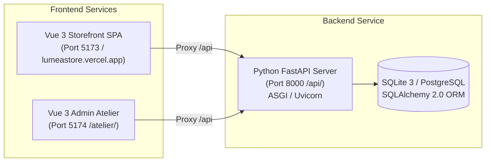

# LUMÉA — Contemporary Skincare & Beauty Atelier E-Commerce Platform

> **University Computer Science Capstone Project**  
> A full-stack, enterprise-grade e-commerce application featuring a **Python 3.12 FastAPI REST API** backend, a **Vue 3 + Vite** Storefront, a dedicated **Vue 3 + Vite** Admin Atelier Console, and curated dermatological datasets.

[](https://github.com/sounvisal/Python-E-Commerce/actions)
[](https://fastapi.tiangolo.com)
[](https://vuejs.org)
[](https://vitejs.dev)
[](https://www.sqlalchemy.org)
[](https://python.org)
[](https://github.com/sounvisal/Python-E-Commerce)

---

## 🏛️ 1. Deliverables & Repository Structure

As required for university final evaluation, this repository is organized into distinct, modular deliverables:

```
d:\lumea/
├── datasets/                        # 📊 Evaluation Datasets & Fixtures
│   ├── catalog_products.json        # 100+ items, categories, brands, clientele, quizzes
│   ├── store_settings.json          # Atelier operational profile, tax rates, logistics
│   └── README.md                    # Data dictionaries, schemas & ingestion documentation
│
├── python-backend/                  # 🐍 Python 3.12 FastAPI REST API Service
│   ├── app/                         # Layered Architecture (api, core, models, schemas, services, seed)
│   ├── tests/                       # 114 Automated PyTest Unit & Security Tests
│   ├── requirements.txt             # Pip dependency specifications
│   ├── test_api.py                  # 30 Comprehensive End-to-End API Integration Tests
│   └── run.py                       # ASGI entrypoint (Uvicorn on Port 8000)
│
├── frontend/                        # 🛍️ Vue 3 Luxury Storefront SPA (Port 5173)
│   ├── src/                         # 40 views, Pinia stores, custom CSS design system
│   ├── tests/                       # 13 Node.js flow & recommendation engine tests
│   └── package.json                 # Client dependencies
│
├── admin/                           # 🎛️ Vue 3 Admin Atelier Back-Office (Port 5174)
│   ├── src/                         # 14 specialized management consoles & analytics
│   └── package.json                 # Admin console dependencies
│
├── tests/                           # 🧪 System-Wide QA & Load Verification
│   └── load/                        # k6 100-user concurrent realistic shopping script
│
├── requirements.txt                 # 📦 Root Python dependencies (mirrored for grading)
├── DEPLOYMENT.md                    # ☁️ Production hosting guide (Render + Vercel)
├── openapi.yaml                     # 📜 Standardized OpenAPI 3.1 Specification
└── README.md                        # 📖 Comprehensive system documentation
```

---

## 🌐 2. System Architecture & Port Mapping

The Luméa system consists of decoupled frontend single-page applications communicating with the Python backend via authenticated RESTful JSON APIs:



| Service | Technology | Local Dev URL | Hosted URL | Purpose |
| :--- | :--- | :--- | :--- | :--- |
| **Storefront** | Vue 3, Pinia, Vue Router, Vite | `http://localhost:5173` | `https://lumeastore.vercel.app/` | Client shopping atelier, reels, quiz, checkout |
| **Admin Console** | Vue 3, Pinia, Chart.js, Vite | `http://localhost:5174` | `https://lumeastore.vercel.app/atelier/` | Back-office management, CMS, analytics, moderation |
| **Backend API** | Python 3.12, FastAPI, SQLAlchemy 2.0 | `http://127.0.0.1:8000` | Render Cloud API | RESTful service with Swagger at `/docs` |
| **Database** | SQLite 3 (Dev) / PostgreSQL (Prod) | `lumea.db` | File / Managed Cloud DB | Zero-config portable database with auto-seeding |

---

## 🎨 3. Key Feature Highlights

### A. Storefront Experience (40 Completed Views & Regimens)
- **Luxury Asian Skincare Aesthetic**: Warm bisque palette (`#F5EFEB`, `#7A2E22`), Playfair serif typography, and tactile minimalist UI polish.
- **Filterable Catalog**: Search by keyword, skin concern (`Dullness`, `Acne`, `Barrier Repair`), skin type (`Dry`, `Oily`, `Combination`), brand, and price bracket.
- **UGC Sensory Video Reels**: 9:16 vertical video reviews showing product textures, reviewer skin profile chips, and a **1-Click Quick-Buy** drawer.
- **Dermatological Diagnostic Quiz**: 5-step interactive diagnostic quiz mapping individual skin biomarkers to morning & evening personalized regimens.
- **National Bank of Cambodia (NBC) Bakong KHQR**: Native EMVCo TLV payload generator with CCITT CRC16 verification, dual USD/KHR currency conversion, and instant bank clearance simulation.
- **Clientele Suite**: Customer account dashboard, order invoice tracking, interactive 5-step return wizard (`/returns/request`), live 7-stage return status timeline, and private daily Skincare Journal.

### B. Admin Atelier Console (14 Specialized Modules)
1. **Executive Dashboard**: Real-time sales curves, channel breakdown donut, low-stock threshold alerts, and recent order stream.
2. **Advanced Analytics**: Category sales ranking, traffic acquisition channels, customer lifetime value segments, and CSV report exports.
3. **Product Catalog Manager**: Formulation editor with rich attributes, skin concerns checklist, texture video uploader, and inventory controls.
4. **Brand Showcases**: Multi-brand directory, featured brand toggles, and brand heritage masterclass video showcase.
5. **Categories CMS**: Hierarchy ordering, visual badge uploads, and storefront navigation visibility toggles.
6. **Order Fulfillment Studio**: 6-stage delivery lifecycle tracker, invoice calculation, and shipping carrier management.
7. **Clientele & VIP Customer Studio**: Spending tiers (`Radiant Gold`, `Silver`, `Bronze`), reward points, addresses, and activity logging.
8. **Promotions & Coupons**: Rule-based discount codes, usage limits, expiration dates, custom coupon banners, and **storefront Hero banner integration**.
9. **Homepage CMS**: Section reordering, layout templates, live storefront preview links, and banner asset manager.
10. **Dermatological Journal CMS**: Editorial publishing workflow, category filters, reading time estimator, and rich article editor.
11. **Review Moderation Studio**: UGC review approval pipeline, video reel preview player, rating analytics, and official atelier reply composer.
12. **Skin Quiz Builder**: 3-column Question Studio Builder with drag-and-drop handles, visual question options, and rule-based recommendation routing.
13. **Returns & Refunds Studio**: 7-reason diagnostic donut chart, return request inspector, and refund clearance flow.
14. **System Settings**: 12 operational configuration tabs (branding, logistics, tax rate, notifications, backup export/import, staff permissions).

---

## 🚀 4. Quick Start Guide (Local Setup)

### Prerequisites:
- **Python 3.12+**
- **Node.js 20+** and **npm**

---

### Step 1: Install Python Dependencies & Launch Backend
You can install dependencies directly from the repository root:

```powershell
# From repository root
cd d:\lumea

# 1. Create and activate virtual environment
python -m venv python-backend/venv
.\python-backend\venv\Scripts\Activate.ps1

# 2. Install requirements (available at root or in python-backend/)
pip install -r requirements.txt

# 3. Start the FastAPI server
cd python-backend
python run.py
```
* **API Base URL**: `http://127.0.0.1:8000/api`
* **Interactive Swagger UI**: `http://127.0.0.1:8000/docs`
* **Health Check**: `http://127.0.0.1:8000/api/health`

---

### Step 2: Launch Vue Storefront
In a new terminal:
```powershell
cd d:\lumea\frontend
npm install
npm run dev
```
* **Storefront URL**: `http://localhost:5173/`

---

### Step 3: Launch Admin Atelier Console
In a new terminal:
```powershell
cd d:\lumea\admin
npm install
npm run dev
```
* **Admin Atelier URL**: `http://localhost:5174/`

---

## 🔑 5. Pre-Configured Demo Credentials

These accounts are seeded automatically for evaluation and grading:

| Role | Email | Password | Access Level / Tier |
| :--- | :--- | :--- | :--- |
| **Storefront Customer** | `sreynich.chan@example.com` | `password123` | *Luméa Radiant Gold* (320 pts, order history, skin profile) |
| **Super Administrator** | `admin@lumea.com` | `password123` | Atelier Full Access (CMS, orders, analytics, moderation) |

---

## 🧪 6. Automated Testing & Quality Assurance

The system includes **157 automated tests** spanning backend unit, security, integration, and client flows:

### 1. Run Complete Backend PyTest Suite (114 Tests)
Validates authentication, catalog filtering, COD stock reservation, transaction safety, payment verification, and security boundaries:
```powershell
cd d:\lumea\python-backend
.\venv\Scripts\python -m pytest tests
```

### 2. Run REST API Verification Suite (30 Tests)
End-to-end integration verification testing every endpoint against a disposable database:
```powershell
cd d:\lumea\python-backend
.\venv\Scripts\python test_api.py
```

### 3. Run Storefront Client & Recommendation Engine Tests (13 Tests)
Validates routine generation algorithms, cart logic, session persistence, and error resilience:
```powershell
cd d:\lumea\frontend
node --test tests/flows.test.mjs tests/recommendations.test.mjs
```

### 4. Run Concurrency Load Testing (100 Simultaneous Shoppers)
Simulates realistic human browsing, category filtering, cart operations, and checkout:
```powershell
k6 run scripts/k6_load_test.js
```

---

## 📡 7. Core REST API Endpoints

| Method | Endpoint | Description | Auth Required |
| :--- | :--- | :--- | :--- |
| `GET` | `/api/health` | Service uptime and system health | Public |
| `GET` | `/api/categories` | Categories catalog with product counters | Public |
| `GET` | `/api/products` | Multi-attribute catalog (search, filter, sort) | Public |
| `GET` | `/api/products/{slug}` | Product specification, ingredients, reviews | Public |
| `POST` | `/api/auth/register` | Customer account registration | Public |
| `POST` | `/api/auth/login` | Bcrypt hashed login with JWT issuance | Public |
| `GET` | `/api/auth/me` | Authenticated customer profile & reward points | Bearer Token |
| `POST` | `/api/orders` | Checkout submission with order code generation | Public / Guest / User |
| `GET` | `/api/orders/{orderNumber}` | Order fulfillment status & timeline | Public / Order Token |
| `POST` | `/api/payments/khqr/generate` | NBC Bakong EMVCo dynamic QR payload | Public |
| `POST` | `/api/payments/khqr/simulate-approve` | Defense demo instant bank approval | Public |
| `GET` | `/api/promotions/featured` | Public active promotions for Hero banner & deals | Public |
| `POST` | `/api/upload` | Validated image uploader (.jpg, .png, .webp) | Authenticated |
| `POST` | `/api/upload/video` | Validated video review uploader (.mp4, .webm) | Authenticated |
| `GET` | `/api/admin/stats` | Executive atelier KPIs and revenue metrics | Admin |
| `GET` | `/api/admin/orders` | Comprehensive orders studio with pagination | Admin |
| `GET` | `/api/admin/customers` | Registered clientele database & VIP metrics | Admin |
| `GET` | `/api/admin/settings` | Operational settings, tax rates, logistics | Admin |

---

## 📄 8. Academic Integrity & Defense Statement

* **Academic Level**: Computer Science Final Project / Capstone Evaluation.
* **Architecture Compliance**: Adheres to Clean Layered Architecture, PEP 8 standards, strict Pydantic schema validation, and Vue 3 Composition API best practices.
* **Defense Readiness**: Zero external paid third-party dependencies required; all Bakong KHQR generators, image streaming handlers, and SQLite databases run locally and portably on any evaluator's workstation.
