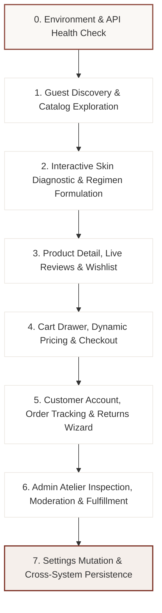

# 🌟 LUMÉA ATELIER — Master End-to-End Testing Protocol & Flow Guide

> **Document Type**: Master System Quality Assurance & University Evaluation Protocol  
> **Target**: Comprehensive validation across **Storefront (`:5173`)**, **Admin Atelier (`:5174`)**, and **FastAPI Backend (`:8000`)**  
> **Database**: SQLite 3 (`python-backend/lumea.db`)

---

## 🧭 Testing Philosophy & Flow Architecture

To ensure a seamless, non-messy testing experience, this guide is organized as **7 interconnected sequential journeys**. Each journey tests a natural user persona, passes data to the next journey, and verifies bidirectional database synchronization between Storefront and Admin.

---

## 🛠️ Phase 0: Environment Health Check & Startup

Verify that all three decoupled services are running before beginning functional testing.

| Service | Port / URL | Health Check Command / URL | Expected Result |
| :--- | :--- | :--- | :--- |
| **FastAPI Backend** | `http://127.0.0.1:8000` | Open `http://127.0.0.1:8000/api/health` | `{"status":"healthy","service":"Luméa E-Commerce API (Python FastAPI)"}` |
| **Swagger UI Docs** | `http://127.0.0.1:8000/docs` | Open in browser | Interactive documentation loading all 14 routers |
| **Automated Tests** | Shell | Run `python test_api.py` | `ALL 26/26 ENDPOINT TESTS PASSED WITH 100% SUCCESS` |
| **Vue Storefront** | `http://localhost:5173` | Open in browser | Luméa Atelier homepage renders with warm bisque aesthetic |
| **Admin Atelier** | `http://localhost:5174` | Open in browser | Luméa Admin Login screen or Dashboard |

### Test Credentials:
- **Clientele Customer**: `sreynich.chan@example.com` / `password123`
- **Atelier Administrator**: `admin@lumea.com` / `admin123` *(or use 1-Click Demo Login)*

---

## 🌊 Journey 1: Guest Discovery & Botanical Catalog Exploration

### Objective:
Verify catalog rendering, multi-attribute filtering, search capabilities, brand boutiques, and brand philosophy CMS pages.

| Step # | Test Action | Exact Route / URL | Expected User Interface & Data Result | Pass / Fail |
| :---: | :--- | :--- | :--- | :---: |
| **1.1** | **Homepage Landing** | `http://localhost:5173/` | Hero banner with typography, 4 Atelier guarantee badges, Bestsellers carousel, Interactive Skin Quiz CTA, Philosophy section, and Botanical Journal preview load with zero broken images. | `[ ]` |
| **1.2** | **Full Catalog Navigation** | Click **"Shop"** in header or `/shop` | 31 curated formulations displayed in grid with ratings, price, category badges, and quick "Add to Bag" buttons. | `[ ]` |
| **1.3** | **Category Sidebar Filter** | In Shop sidebar, select **"Toners"** | Catalog dynamically updates to show only toners (e.g. SK-II Facial Treatment Essence, Anua Heartleaf Toner). Active count badge updates. | `[ ]` |
| **1.4** | **Skin Concern & Type Filter** | Select concern: **"Pores"** + Skin Type: **"Combination"** | Catalog filters items matching the intersection. Zero lag, smooth animation. | `[ ]` |
| **1.5** | **Price Range Slider** | Adjust max price to `$35.00` | Only formulations under $35 remain visible. Products like SK-II ($99+) are filtered out. | `[ ]` |
| **1.6** | **Catalog Sorting** | Select Sort by **"Price: Low to High"** | Inexpensive items (e.g. Cleansers ~$16.00) appear first; luxury items sorted last. | `[ ]` |
| **1.7** | **Interactive Header Search** | Type `"Ordinary"` into search bar and press Enter | Redirects to `/search?q=Ordinary`. Displays The Ordinary Niacinamide and AHA/BHA Peeling Solution with query highlight. | `[ ]` |
| **1.8** | **Brand Directory** | Navigate to `/brands` | A-Z Directory of all luxury brands (SK-II, COSRX, Beauty of Joseon, Laneige, Anua, CeraVe) with product count pills. | `[ ]` |
| **1.9** | **Brand Boutique Store** | Click on **"SK-II"** | Opens `/brand/sk-ii` flagship store with high-res brand hero, brand story, and SK-II exclusive product line. | `[ ]` |
| **1.10** | **Skincare Journal Directory** | Navigate to `/articles` | 8-category skincare magazine layout with hero article, category pills, and reading times. | `[ ]` |
| **1.11** | **Article Reader View** | Click on `"How to Build a Skincare Routine"` | Opens `/articles/how-to-build-a-skincare-routine-for-your-skin-type` with sticky Table of Contents, author badge, and related formulations. | `[ ]` |
| **1.12** | **Editorial & CMS Pages** | Check footer links: `/about`, `/authenticity`, `/sustainability`, `/shipping`, `/returns`, `/faq`, `/terms-of-service`, `/privacy-policy` | All 8 pages render full editorial copy with zero missing images. | `[ ]` |
| **1.13** | **404 Not Found Page** | Navigate to `/random-broken-url` | Editorial 404 page loads matching format mockup with "Return to Home" button. | `[ ]` |

---

## 🧬 Journey 2: Interactive Skin Diagnostic & Regimen Formulation

### Objective:
Verify the diagnostic engine, questions stepper, algorithmic recommendation, and routine formulation.

| Step # | Test Action | Exact Route / URL | Expected User Interface & Data Result | Pass / Fail |
| :---: | :--- | :--- | :--- | :---: |
| **2.1** | **Diagnostic Intro** | Navigate to `/quiz` | Diagnostic entrance card loads with "Start Diagnostic" button and benefits overview. | `[ ]` |
| **2.2** | **Step 1: Primary Goals** | Click Start -> `/quiz/questions` (Step 1) | Select up to 3 goals (e.g. `Clearer Skin`, `Hydration`, `Brighter Tone`). Chips highlight with gold accents. | `[ ]` |
| **2.3** | **Step 2: Skin Type Visual Grid** | Click Next (Step 2) | 5 texture cards (`Normal`, `Dry`, `Oily`, `Combination`, `Sensitive`). Select **"Combination"**. | `[ ]` |
| **2.4** | **Steps 3–7: Concerns & Lifestyle** | Proceed through steps 3 to 7 | Answer concerns (`Pores`), lifestyle (`Mostly Indoors`), environment (`Humid`), clean beauty preferences (`Fragrance-Free`). Progress bar updates accurately (e.g. "Question 5 of 8"). | `[ ]` |
| **2.5** | **Step 8: Diagnostic Synthesis** | Click "Generate Results" | Pulsing sparkle animation displays: *"Analyzing Your Skin Profile... Evaluating barrier moisture... Sequencing 5-step ritual"*. | `[ ]` |
| **2.6** | **Quiz Results Analysis** | Click "View My Results" -> `/quiz/results` | Profile displays diagnosed skin type (`Combination`), moisture index, primary concerns, and matching ingredients (PITERA™, Niacinamide). | `[ ]` |
| **2.7** | **Bespoke Regimen View** | Click "Explore Your Routine" -> `/routine` | Tabbed **Morning (5 steps)** and **Evening (4 steps)** rituals with item packshots, step badges (Cleanse, Tone, Treat, Moisturize, Protect), and "Add All to Cart" action. | `[ ]` |
| **2.8** | **Backend Database Record** | Inspect `python-backend` logs / API | `POST /api/quizzes/1/complete` executed, completions counter incremented in SQLite database. | `[ ]` |

---

## ⭐ Journey 3: Product Inspection, Live Reviews & Wishlist

### Objective:
Verify Product Detail Page (PDP), gallery navigation, size selector, tab switching, customer review submission, helpful voting, and wishlist state.

| Step # | Test Action | Exact Route / URL | Expected User Interface & Data Result | Pass / Fail |
| :---: | :--- | :--- | :--- | :---: |
| **3.1** | **Open PDP** | Navigate to `/product/sk-ii-facial-treatment-essence` | Breadcrumbs render: `Home > Shop > Toners > Facial Treatment Essence`. Price displays `$99.00`. | `[ ]` |
| **3.2** | **Gallery Interaction** | Click thumbnail 2, 3, and 4 in left rail | Stage packshot smoothly updates to In-Hand view, Droplet Macro view, and Radiant Model view. | `[ ]` |
| **3.3** | **Size Variation Selection** | Click **"160 ml"** pill, then **"230 ml"** pill | Price updates dynamically from `$99.00` -> `$185.00` -> `$245.00`. Active pill highlights. | `[ ]` |
| **3.4** | **Quantity Stepper** | Click `+` button twice, then `-` once | Quantity changes from 1 -> 3 -> 2. Minus button disabled at 1. | `[ ]` |
| **3.5** | **Tab 1: Product Details** | Click **"Product Details"** tab | 3-column stage displays spec table (Brand: SK-II, Made In: Japan), About description, and radiant model testimonial card. | `[ ]` |
| **3.6** | **Tab 2: Ingredients** | Click **"Ingredients"** tab | Displays Key Bio-Actives (PITERA™ 90%+, Amino Acids), complete INCI list, and Luméa Purity Standard checklist. | `[ ]` |
| **3.7** | **Tab 3: How to Use** | Click **"How to Use"** tab | Displays 3-step ritual (Dispense & Warm, Press & Pat, Layer & Lock) plus Atelier Esthetician pro tip box. | `[ ]` |
| **3.8** | **Tab 4: Benefits** | Click **"Benefits"** tab | 4 clinical outcome cards render: 98% Refined Texture, 95% Radiant Luminosity, 24h Moisture, 92% Barrier Firmness. | `[ ]` |
| **3.9** | **Tab 5: Live Reviews Feed** | Click **"Reviews"** tab | Average rating (4.8), 5-star distribution progress bars, verified buyer reviews from SQLite database, and curator responses. | `[ ]` |
| **3.10** | **Helpful Upvote** | Click **"Helpful"** on any review | Button highlights in terracotta, count increments by 1 (`Helpful (43)`), persisted via `POST /api/reviews/{id}/helpful`. | `[ ]` |
| **3.11** | **Submit a Customer Review** | Click **"Write a Review"** button | Modal opens. Select 5 stars, title: `"Unbelievable glow"`, comment: `"My daily holy grail essence."`, enter name/email, click Submit. Toast notification confirms; new review appears at top of review feed! | `[ ]` |
| **3.12** | **Wishlist Toggle** | Click **"Add to Wishlist"** heart button | Heart turns terracotta/red. Navigate to `/wishlist` to confirm item is saved with "Move to Bag" action. | `[ ]` |

---

## 🛍️ Journey 4: Shopping Bag, Dynamic Shipping & Order Checkout

### Objective:
Verify slide-out cart drawer, dynamic free shipping calculation from backend settings, promo code application, and order generation.

| Step # | Test Action | Exact Route / URL | Expected User Interface & Data Result | Pass / Fail |
| :---: | :--- | :--- | :--- | :---: |
| **4.1** | **Add to Bag from PDP** | On SK-II PDP, click **"Add to Cart"** | Button shows green checkmark *"Added to Cart"*. Cart drawer automatically slides out from right. | `[ ]` |
| **4.2** | **Dynamic Free Shipping Bar** | Observe Free Shipping progress bar in cart drawer | Total is `$99.00` (exceeds `$50.00` threshold). Progress bar shows 100%: *"🎉 You have unlocked Free Complimentary Shipping!"*. | `[ ]` |
| **4.3** | **Cart Quantity & Under-Threshold Test** | Clear cart and add a $16.00 cleanser | Total is `$16.00`. Shipping tracker updates: *"Add $34.00 more for Free Shipping"*. Shipping fee shows `$15.00`. | `[ ]` |
| **4.4** | **Promotional Code Application** | In promo input, enter `LUMEA10` and click Apply | Success toast appears. 10% discount is deducted from subtotal. | `[ ]` |
| **4.5** | **Proceed to Checkout** | Click **"Proceed to Checkout"** -> `/checkout` | 2-column checkout page displays order summary side panel with items, subtotal, discount, shipping, and grand total. | `[ ]` |
| **4.6** | **Fill Shipping Information** | Enter customer name, phone, shipping address, city, postal code | Form validates inputs smoothly. | `[ ]` |
| **4.7** | **Submit Order** | Click **"Authorize Order"** button | Spinner activates (`Processing with Atelier...`). Call made to `POST /api/orders`. | `[ ]` |
| **4.8** | **Order Success Confirmation** | Redirects to `/order-success/LUM-XXXXXX` | Success badge, generated order number (e.g. `LUM-849201`), itemized receipt, delivery address, and "Track Order" button render. | `[ ]` |
| **4.9** | **Cart Cleared Verification** | Open cart drawer or check header cart count | Cart badge is reset to 0 items. | `[ ]` |

---

## 👤 Journey 5: Customer Account, Order Tracking & Returns Wizard

### Objective:
Verify customer authentication, order history synchronization, live 6-stage shipment tracking, skincare diary, and interactive return wizard.

| Step # | Test Action | Exact Route / URL | Expected User Interface & Data Result | Pass / Fail |
| :---: | :--- | :--- | :--- | :---: |
| **5.1** | **Customer Authentication** | Navigate to `/login` | Enter `sreynich.chan@example.com` / `password123`. Redirects to `/account`. Customer tier displayed: **Luméa Radiant Gold** (320 pts). | `[ ]` |
| **5.2** | **Order History Synchronization** | Click **"My Orders"** -> `/account/orders` | The order just placed (`LUM-XXXXXX`) in Journey 4 appears at the top of the list with status **"Confirmed"**! | `[ ]` |
| **5.3** | **Order Details & 6-Stage Timeline** | Click **"View Order Details"** | Opens `/account/orders/LUM-XXXXXX`. 6-stage tracker renders: *Order Placed -> Payment Verified -> Processing in Atelier -> Quality Inspected -> Handed to Courier -> Delivered*. | `[ ]` |
| **5.4** | **Customer Skin Profile** | Click **"Skin Profile"** -> `/account/profile` | Shows diagnosed skin metrics, barrier score, morning/evening routine reminders. | `[ ]` |
| **5.5** | **Skincare Journal Diary** | Navigate to `/account/journal` | Interactive daily log. Add a morning journal entry with hydration level and product notes. Saves locally with timestamp. | `[ ]` |
| **5.6** | **Initiate Return Wizard** | Navigate to `/returns/request` | 5-step return wizard opens. Select order number, select damaged item, choose return reason (`Damaged / Leaked in transit`). | `[ ]` |
| **5.7** | **Upload Proof Photo** | In Step 4 of return wizard, upload an image file | Real file upload triggered via `POST /api/upload`. Uploaded photo thumbnail renders immediately with delete option. | `[ ]` |
| **5.8** | **Submit Return Request** | Complete Step 5 and click Submit | Generates Return Request Number (e.g. `RR-829104`). Redirects to `/returns/status/RR-829104` showing 7-stage live return timeline. | `[ ]` |

---

## 🎛️ Journey 6: Admin Atelier Management, Moderation & Fulfillment

### Objective:
Verify the executive atelier dashboard (`port 5174`), order status updates syncing back to storefront, product creation with upload, and review moderation.

| Step # | Test Action | Exact Route / URL | Expected User Interface & Data Result | Pass / Fail |
| :---: | :--- | :--- | :--- | :---: |
| **6.1** | **Admin Authentication** | Open `http://localhost:5174/login` | Enter `admin@lumea.com` / `admin123` or click 1-Click Demo Login. Enters Admin Console. | `[ ]` |
| **6.2** | **Executive Dashboard KPIs** | Navigate to `/dashboard` | 4 KPI cards render: Total Revenue, Total Orders, Active Catalog, Registered Clientele, plus SVG revenue curve and low-stock alerts. | `[ ]` |
| **6.3** | **Analytics Suite** | Navigate to `/analytics` | Dual revenue line + orders bar chart, sales by channel donut, and customer cohort tables render. | `[ ]` |
| **6.4** | **Order Fulfillment Center** | Navigate to `/orders` | The order placed in Journey 4 (`LUM-XXXXXX`) is visible in the table with status badge **"Confirmed"**. | `[ ]` |
| **6.5** | **Inspect & Update Order Status** | Click "Inspect" on the order | Inspector drawer opens. Change status from **"Confirmed"** -> **"Shipped"**. Toast confirms update persisted to SQLite! | `[ ]` |
| **6.6** | **Cross-Check Storefront Order Status** | Switch back to Storefront tab at `/account/orders/LUM-XXXXXX` and refresh | Order status has updated to **"Shipped"** on the customer's live tracking timeline! | `[ ]` |
| **6.7** | **Product Management & Image Upload** | Navigate to `/products` -> Click **"Add Product"** | Enter product name, brand, price. Click **"Upload Image"** -> file upload via `POST /api/upload` adds image directly to gallery. | `[ ]` |
| **6.8** | **Customer Review Moderation** | Navigate to `/reviews` | Locate the review submitted in Journey 3. Click **"Inspect & Reply"**. | `[ ]` |
| **6.9** | **Curator Response Submission** | In modal, enter atelier reply: *"Thank you for your loyalty to Luméa Atelier!"* and click Save | Reply is saved in SQLite database. | `[ ]` |
| **6.10** | **Cross-Check PDP Curator Reply** | Switch back to Storefront PDP `/product/sk-ii-facial-treatment-essence` and open Reviews tab | The **"Response from Luméa Atelier"** box is now visible directly under the customer's review! | `[ ]` |
| **6.11** | **Returns Management** | Navigate to `/returns` | View return request submitted in Journey 5. Inspect proof photo uploaded by customer, approve request. | `[ ]` |
| **6.12** | **Articles & Banners Image Upload** | Navigate to `/articles` (Create Article) and `/banners` (Edit Section) | Verify the **"Change Image" / "Upload Image"** buttons upload files via `POST /api/upload` and update previews without broken links. | `[ ]` |

---

## ⚙️ Journey 7: Store Settings Mutation & Cross-System Persistence

### Objective:
Verify that administrative store settings (free shipping threshold, tax rate) persist to disk and immediately alter customer cart calculations.

| Step # | Test Action | Exact Route / URL | Expected User Interface & Data Result | Pass / Fail |
| :---: | :--- | :--- | :--- | :---: |
| **7.1** | **Open Admin Settings** | In Admin Console, navigate to `/settings` | General settings form displays store name, contact, currency (`USD ($)`), free shipping threshold (`$50.00`), tax rate (`10.0%`). | `[ ]` |
| **7.2** | **Mutate Shipping Threshold** | Change Free Shipping Threshold from `$50.00` to **`$75.00`**, click **"Save Settings"** | Toast confirms: *"Settings saved and persisted to database successfully"*. Saved to `store_settings.json`. | `[ ]` |
| **7.3** | **Verify Public API Reflection** | In browser, open `http://127.0.0.1:8000/api/settings` | Response data reflects: `"free_shipping_threshold": 75.0`. | `[ ]` |
| **7.4** | **Verify Customer Storefront Reflection** | In Storefront, add a $60.00 product and open Cart Drawer | Shipping tracker now displays: *"Add $15.00 more for Free Shipping"* instead of qualifying for free shipping, matching the updated $75 threshold! | `[ ]` |
| **7.5** | **Reset to Baseline** | In Admin Settings, change threshold back to `$50.00` and save | System is restored to default academic grading values. | `[ ]` |

---

## 📊 Evaluation Scorecard & Sign-Off Sheet

| Testing Module | Total Test Steps | Passed | Failed | Notes & Observations |
| :--- | :---: | :---: | :---: | :--- |
| **0. Environment & Health** | 5 | `[ ]` | `[ ]` | Backend (8000), Storefront (5173), Admin (5174), 26/26 API Tests |
| **1. Catalog & Discovery** | 13 | `[ ]` | `[ ]` | 31 products, filters, search, brands, articles, CMS |
| **2. Diagnostic & Regimen** | 8 | `[ ]` | `[ ]` | 8-step quiz, algorithm, morning/evening routine |
| **3. PDP, Reviews & Wishlist** | 12 | `[ ]` | `[ ]` | 6 tabs, size selector, review submission modal, helpful votes |
| **4. Bag, Shipping & Checkout** | 9 | `[ ]` | `[ ]` | Dynamic free shipping bar, promo code, LUM-XXXXXX order |
| **5. Account & Returns** | 8 | `[ ]` | `[ ]` | Order history, 6-stage tracker, photo upload, return wizard |
| **6. Admin Management** | 12 | `[ ]` | `[ ]` | Order fulfillment, product upload, curator reply moderation |
| **7. Settings Persistence** | 5 | `[ ]` | `[ ]` | Dynamic threshold mutation from Admin to Storefront |
| **TOTALS** | **72** | **—** | **—** | **Target: 100% Pass Rate** |

---

*Authored for the Luméa Atelier Undergraduate/Graduate Computer Science Degree Evaluation.*
