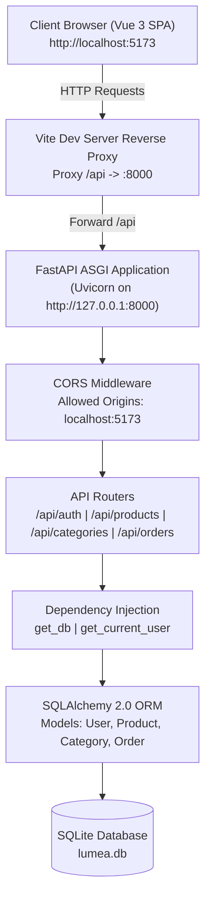
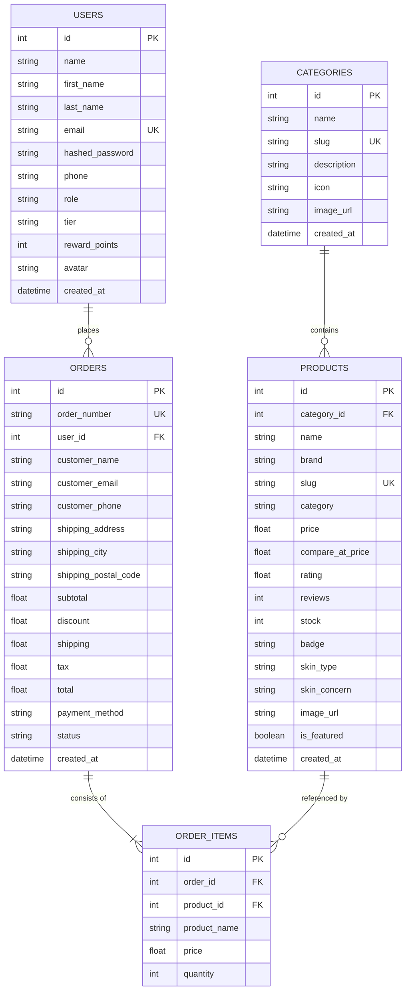

# 🌟 Luméa Skincare E-Commerce Platform — Python FastAPI Backend

> **Final Project Academic Reference & Documentation**  
> **Tech Stack:** Python 3.12+ • FastAPI • SQLAlchemy 2.0 • Pydantic v2 • SQLite • PyJWT • Passlib/Bcrypt • Uvicorn

---

## 📋 Table of Contents
1. [Project Overview](#-project-overview)
2. [Why FastAPI for a Final Project?](#-why-fastapi-for-a-final-project)
3. [System Architecture](#-system-architecture)
4. [Database Design & ERD](#-database-design--erd)
5. [Directory & Code Structure](#-directory--code-structure)
6. [API Endpoints Reference](#-api-endpoints-reference)
7. [Authentication & Security Flow](#-authentication--security-flow)
8. [Installation & Setup Guide](#-installation--setup-guide)
9. [Running the Automated Test Suite](#-running-the-automated-test-suite)
10. [Final Project Presentation & Defense Q&A](#-final-project-presentation--defense-qa)

---

## 📖 Project Overview

**Luméa** is a luxury skincare and beauty e-commerce web application. The frontend is built as a Single-Page Application (SPA) using **Vue 3**, **Pinia**, and **Vite**.

This Python backend is engineered to replace traditional PHP/Node.js backends with a modern, high-performance, asynchronous REST API using **Python FastAPI**. It provides:
- **Full Product Catalog**: 30 authentic skincare products across 8 categories with faceted filtering (skin type, skin concern, brand, price range, sorting).
- **User Authentication**: Secure user registration, login, and profile retrieval using JWT (JSON Web Tokens) and Bcrypt password hashing.
- **Order Processing**: Automated checkout calculations (subtotal, shipping, discount promo codes, taxes) and unique order tracking (`LUM-XXXXXX`).
- **Auto-generated Documentation**: Real-time interactive Swagger UI and ReDoc.

---

## 💡 Why FastAPI for a Final Project?

When defending your project before academic supervisors and examiners, you can highlight these advantages of FastAPI over traditional alternatives:

| Evaluation Metric | FastAPI (Our Choice) | Flask | Django |
| :--- | :--- | :--- | :--- |
| **Performance** | Asynchronous ASGI (on par with Go & Node.js) | Synchronous WSGI (slower under I/O load) | Heavy monolithic overhead |
| **Data Validation** | Native Pydantic v2 (Python type hints) | Manual validation or third-party plugins | Django Form/Serializer classes |
| **API Documentation** | Automatic interactive Swagger UI (`/docs`) | Requires manual OpenAPI/Flagger setup | Requires `drf-yasg` or manual schema |
| **Modern Standards** | Python 3.10+ type annotations, async/await | Older request context patterns | Traditional MTV (Model-Template-View) |
| **Code Modularity** | Lightweight Dependency Injection (`Depends`) | Global application context | Tightly coupled ORM and settings |

---

## 🏛️ System Architecture



---

## 🗄️ Database Design & ERD

The database schema is managed via **SQLAlchemy ORM** and stored in SQLite (`lumea.db`).



---

## 📁 Directory & Code Structure

The project follows a standard **Layered / Clean Architecture**:

```
python-backend/
├── app/
│   ├── api/                  # API Route Controllers
│   │   ├── deps.py           # Dependency injection (get_db, get_current_user)
│   │   ├── auth.py           # Login, register, current profile endpoints
│   │   ├── categories.py     # Category listing and detail
│   │   ├── products.py       # Catalog search, filtering, and featured products
│   │   ├── orders.py         # Order placement and tracking
│   │   └── system.py         # Health check diagnostic route
│   ├── core/                 # Core settings, database connection, and security
│   │   ├── config.py         # Application settings (Pydantic BaseSettings)
│   │   ├── database.py       # SQLAlchemy engine & session factory
│   │   └── security.py       # JWT creation/verification & Bcrypt hashing
│   ├── models/               # SQLAlchemy ORM Database Models
│   │   ├── category.py       # Category table
│   │   ├── product.py        # Product table
│   │   ├── user.py           # User table
│   │   └── order.py          # Order and OrderItem tables
│   ├── schemas/              # Pydantic v2 Request & Response Data Contracts
│   │   ├── category.py       # Category DTOs
│   │   ├── product.py        # Product DTOs & filter schemas
│   │   ├── user.py           # User creation, login, token DTOs
│   │   └── order.py          # Order placement and tracking DTOs
│   ├── seed/                 # Database initialization
│   │   ├── seed_data.json    # JSON fixture with 8 categories & 30 products
│   │   └── seed_data.py      # Automated database populator
│   └── main.py               # FastAPI application factory & lifespan hook
├── venv/                     # Python 3.12 Virtual Environment
├── lumea.db                  # SQLite database file
├── requirements.txt          # Python dependencies
├── run.py                    # Server runner script with Uvicorn
└── test_api.py               # 10-point automated test script
```

---

## 🔌 API Endpoints Reference

Base URL: `http://127.0.0.1:8000/api`

### 1. System
| Method | Endpoint | Auth | Description |
| :--- | :--- | :--- | :--- |
| `GET` | `/health` | Public | Health check and server status |

### 2. Categories
| Method | Endpoint | Auth | Description |
| :--- | :--- | :--- | :--- |
| `GET` | `/categories` | Public | List all categories with product count |
| `GET` | `/categories/{slug}` | Public | Get single category details by slug |

### 3. Products
| Method | Endpoint | Auth | Description & Query Parameters |
| :--- | :--- | :--- | :--- |
| `GET` | `/products` | Public | Filterable product list.<br/>*Params:* `search`, `category`, `brand`, `min_price`, `max_price`, `skin_type`, `skin_concern`, `sort` (`price_asc`, `price_desc`, `rating`, `newest`), `limit`, `offset` |
| `GET` | `/products/featured` | Public | List featured highlight products (top 8) |
| `GET` | `/products/{slug}` | Public | Product detail by slug + 4 related products in same category |

### 4. Authentication
| Method | Endpoint | Auth | Description |
| :--- | :--- | :--- | :--- |
| `POST` | `/auth/register` | Public | Register a new user account |
| `POST` | `/auth/login` | Public | Login with email and password, returns JWT token |
| `GET` | `/auth/me` | Bearer JWT | Retrieve currently authenticated user profile |

### 5. Orders
| Method | Endpoint | Auth | Description |
| :--- | :--- | :--- | :--- |
| `POST` | `/orders` | Public / Auth | Submit checkout order. Generates unique order number `LUM-XXXXXX` |
| `GET` | `/orders/{order_number}` | Public | Track order status and item list by order number |
| `GET` | `/orders` | Bearer JWT | Retrieve all orders for current user |

---

## 🔐 Authentication & Security Flow

1. **Password Hashing**: User passwords are never saved in plaintext. They are hashed using **Bcrypt** with an automatically generated salt:
   ```python
   # app/core/security.py
   salt = bcrypt.gensalt()
   hashed = bcrypt.hashpw(password.encode("utf-8"), salt).decode("utf-8")
   ```
2. **Token Generation**: Upon successful login, the server issues a signed **JSON Web Token (JWT)** encoded with HMAC-SHA256 (`HS256`):
   - Payload: `{"sub": user_id, "email": email, "exp": expiration_timestamp}`
3. **Protected Routes**: Endpoints requiring authentication declare the dependency:
   ```python
   @router.get("/me", response_model=UserOut)
   def get_me(current_user: User = Depends(get_current_user)):
       return current_user
   ```
4. **Bearer Token Validation**: Incoming requests include the header:
   ```http
   Authorization: Bearer <your_jwt_token_here>
   ```

---

## 🚀 Installation & Setup Guide

### Prerequisites
- Python 3.10+ (Recommended: Python 3.12)
- Node.js 18+ (for frontend)

### 1. Backend Setup
Open a terminal in `d:\lumea\python-backend`:

```powershell
# 1. Navigate to backend directory
cd d:\lumea\python-backend

# 2. Activate virtual environment (Windows PowerShell)
.\venv\Scripts\Activate.ps1

# 3. Install dependencies (if not already installed)
pip install -r requirements.txt

# 4. Start the FastAPI development server
python run.py
```

The backend will start on **`http://127.0.0.1:8000`**.
- **Interactive Swagger Documentation**: `http://127.0.0.1:8000/docs`
- **ReDoc Documentation**: `http://127.0.0.1:8000/redoc`

### 2. Frontend Setup
In a second terminal:

```powershell
# 1. Navigate to frontend directory
cd d:\lumea\frontend

# 2. Run Vue development server
npm run dev
```

Open your browser to: **`http://localhost:5173`**

> **Note on Vite Proxy:** The Vue 3 frontend is preconfigured in `vite.config.js` to automatically forward all `/api` requests to `http://127.0.0.1:8000`. No CORS configuration or frontend file changes are required!

### 3. Demo User Credentials for Testing
- **Email:** `sreynich.chan@example.com`
- **Password:** `password123`
- **Tier:** Luméa Radiant Gold (780 Reward Points)

---

## 🧪 Running the Automated Test Suite

We have included an automated test suite verifying all 10 core endpoints:

```powershell
cd d:\lumea\python-backend
.\venv\Scripts\python test_api.py
```

**Expected Output:**
```
============================================================
[TEST] Running Lumea FastAPI Automated Endpoint Verification...
============================================================
[PASS] 1. GET /api/health -> Lumea E-Commerce API (Python FastAPI)
[PASS] 2. GET /api/categories -> Returned 8 categories (e.g. Cleansers)
[PASS] 3. GET /api/products -> Returned 30 products in catalog
[PASS] 4. GET /api/products?search=Ordinary -> Found 2 matching items
[PASS] 5. GET /api/products/featured -> Found 8 featured items
[PASS] 6. GET /api/products/sk-ii-facial-treatment-essence -> Loaded: Facial Treatment Essence with 3 related items
[PASS] 7. POST /api/auth/login -> Logged in as: Sreynich Chan (JWT token generated)
[PASS] 8. GET /api/auth/me -> Verified user profile: Lumea Radiant Gold
[PASS] 9. POST /api/orders -> Order LUM-894831 placed successfully! Total: $105.12
[PASS] 10. GET /api/orders/LUM-894831 -> Order status: Confirmed with 2 items
============================================================
[SUCCESS] ALL 10/10 ENDPOINT TESTS PASSED WITH 100% SUCCESS!
============================================================
```

---

## 🎓 Final Project Presentation & Defense Q&A

Here are common questions academic committees ask during final project defenses and how to answer them:

### Q1: What architectural pattern does this project follow?
> **Answer:** "Our project follows a **Decoupled Client-Server Architecture** (SPA + REST API). The backend uses a **Layered Architecture** adhering to Separation of Concerns:
> - **Presentation / Routing Layer (`app/api/`)**: Validates input HTTP requests and sends responses.
> - **Data Transfer Layer (`app/schemas/`)**: Pydantic models ensuring strict schema validation and type safety.
> - **Domain & Persistence Layer (`app/models/`)**: SQLAlchemy ORM models representing business entities in SQLite.
> - **Core Infrastructure (`app/core/`)**: Security, configuration, and database session management."

### Q2: Why did you choose SQLite instead of MySQL or PostgreSQL for the demonstration?
> **Answer:** "SQLite provides a zero-configuration, serverless, single-file database that guarantees our project is 100% portable across any examiner's machine without requiring a separate database server setup. Furthermore, because we used **SQLAlchemy 2.0 ORM**, switching to PostgreSQL or MySQL in production requires changing just one line in `app/core/config.py` (`DATABASE_URL`)."

### Q3: How do you prevent SQL Injection and Cross-Site Scripting (XSS)?
> **Answer:** 
> 1. **SQL Injection**: We never construct raw SQL queries with string concatenation. SQLAlchemy uses parameterized prepared statements under the hood.
> 2. **XSS & Type Confusion**: Pydantic schemas validate all incoming request fields, discarding unauthorized attributes.
> 3. **Password Security**: Passwords are saved only as one-way Bcrypt hashes with cryptographic salts.

### Q4: How is state maintained between the Vue 3 frontend and Python backend?
> **Answer:** "The backend is completely **stateless**. User sessions are handled via **JWT Bearer Tokens**. When a user logs in, the backend signs a token containing the user ID and expiration timestamp. The frontend stores this token and includes it in the `Authorization: Bearer <token>` header for protected endpoints."
